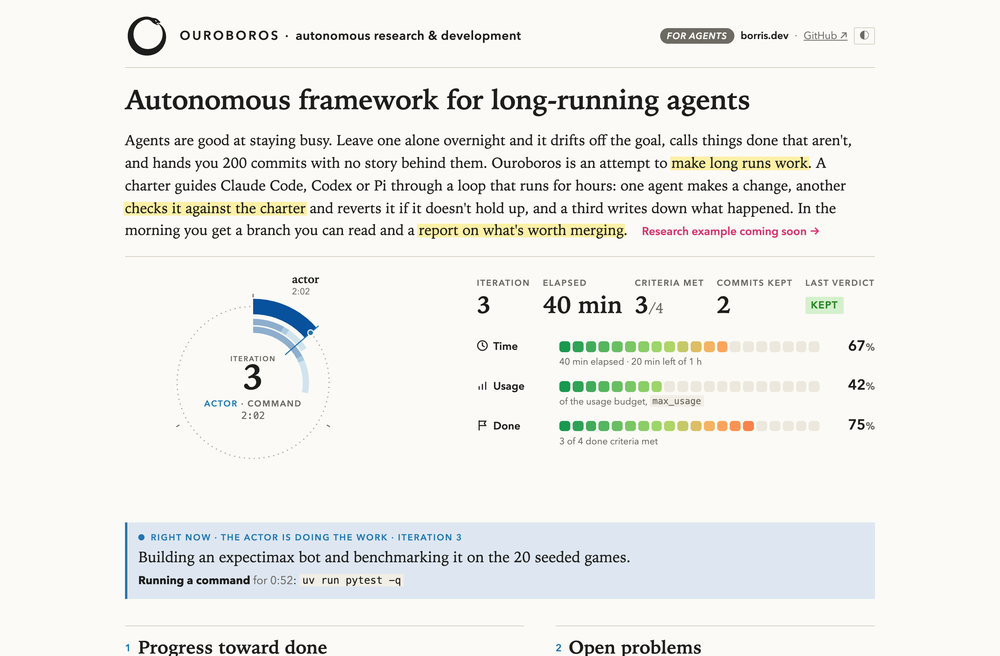

<p align="center">
  <picture>
    <source media="(prefers-color-scheme: dark)" srcset="docs/logo-dark.svg">
    
  </picture>
</p>

<h1 align="center">Ouroboros</h1>

<p align="center"><b>Autonomous framework for long-running agents</b></p>

<p align="center">
  <a href="https://borris.dev"></a>
  
  <a href="https://docs.astral.sh/uv/"></a>
  
  
  <a href="LICENSE"></a>
</p>

---

Agents are good at staying busy. Leave one alone overnight and it drifts off
the goal, calls things done that aren't, and hands you 200 commits with no
story behind them. Ouroboros is an attempt to make long runs work. A charter
guides Claude Code, Codex or Pi through a loop that runs for hours: one agent
makes a change, another checks it against the charter and reverts it if it
doesn't hold up, and a third writes down what happened. In the morning you get
a branch you can read and a report on what's worth merging.

<a href="https://borris.dev">
  <picture>
    <source media="(prefers-color-scheme: dark)" srcset="docs/site-dark.png">
    
  </picture>
</a>

## Install

You need Python 3.12+, [`uv`](https://docs.astral.sh/uv/), and at least one
logged-in agent CLI: `claude`, `codex` or `pi`. To outlive the terminal, a run
uses tmux, tern or a systemd user session (`launcher:` in the config).

```bash
git clone https://github.com/theo-kirby/ouroboros.git && cd ouroboros
uv tool install --editable .
ouroboros skills install --user
```

## Run

In the repo you want worked on, from a clean working tree:

```bash
ouroboros init            # config and charter template
ouroboros design          # write the charter with an agent, by interview
ouroboros run --for 8h    # start the loop (and the phone reporter)
ouroboros top             # watch it
ouroboros view            # its live page in a browser
ouroboros report          # read what happened
ouroboros stop            # stop early
```

`ouroboros` with no arguments opens a menu. Read the report and the run branch
before you merge.

## How it works

| Role | Each iteration |
|---|---|
| **Actor** | Does one unit of work from the critic's prompt, to the end, and tests it. |
| **Critic** | Read-only. Grades the change against the charter, reverts what fails, refuses an unsupported "done", answers the actor's questions as you would, and writes the next prompt. |
| **Scribe** | Records what happened (a rejected change as a dead end), folds the memory when due, and updates the run's page. |

**The charter** (`.ouroboros/goal.md`) speaks for you while you are away: a
mission, done criteria written as claims about the world, a horizon ladder, constraints,
a question policy and a quality bar. No agent can edit it. "Done" is a verdict,
not a stop: once the criteria are met, the run climbs the horizon ladder.

**It never blocks.** Questions go to the critic. A usage limit switches the role
to its fallback harness or waits for access to return. Only a stop you set ends
a run: `stop.after`, `until`, `max_iterations`, `max_usage`, or a long run of
"stuck" verdicts.

**It watches for motion without progress.** Two counters an agent cannot argue
with: 8 iterations that change only bookkeeping, or 30 that leave the frontier
unchanged. The next prompt names the loop; if it goes on, the actor moves to its
fallback model.

## Configuration

`.ouroboros/config.yml`, for example:

```yaml
loop: standard
roles:
  actor:  { harness: claude, timeout: 90m, fallback: [{ harness: codex }] }
  critic: { harness: codex,  timeout: 10m, fallback: [{ harness: claude }] }
  scribe: { harness: claude, model: sonnet, fallback: [{ harness: codex }] }
stop: { after: 8h, max_usage: 0.8 }
memory: auto
```

**The default loop, `loop: worker-writer`**: a worker does each unit from a
fresh context, and a writer (also fresh every turn, and the only memory writer)
reviews it against the charter, records it, grows the memory's claim tree, and
names the claim the next unit works on. Nothing is reverted; a failed turn is
recorded and fixed forward. The worker always gets that target claim whole;
`handoff: graph | both | prompt` says what comes with it: the memory's brief
(`graph`, the default: the claim's `Next:` line is the step), a prose step as well
(`both`), or the prose step without the brief (`prompt`):

```yaml
loop: worker-writer        # the default; `loop: standard` is actor, critic, scribe
handoff: graph
roles:
  worker: { harness: claude, model: claude-opus-5-5, timeout: 45m, fallback: [{ harness: codex }] }
  writer: { harness: claude, model: claude-opus-5-5, timeout: 20m, fallback: [{ harness: codex }] }
```

A subscription rations by window, so a run meters windows, not dollars.
`max_usage` stops the run when any window of a day or longer (in practice the
weekly one) reaches that fraction; five-hour windows refill on their own.
`cost_usd` is priced at API list rates, not your bill. After switching a login
or getting usage back, `ouroboros refresh` rechecks the accounts and wakes a
waiting run.

## The run's page

Every run keeps a live page at `.ouroboros/runs/<run>/view/index.html`: the
loop as a dial, the key figures, gauges for time, usage and progress toward
done, the criteria, open problems, the memory graph, the scribe's findings and
a timeline of every iteration.

When the run stops, `profile: research` makes its findings a poster: one designed
sheet (1800 x 2400 px, rendered to PNG and PDF) with the finding as its title, a
dominant picture and a few supporting ones, and what is next (DESIGN.md section
26). `publication: {style: swiss}` or `dark` changes its look from the default
`infographic`; `publication: {template: paper}` asks for a paper instead: an
answer up front, at most five numbered figures of lettered panels, negative
results, limitations and methods. `profile: development` makes a product report:
what it does, with screenshots, status against the criteria, known bugs and how to
run it. `publication:` in the config tunes the template, the figures and the
cadence (DESIGN.md section 23), and `ouroboros publish --template poster` writes a
stopped run's report again, in any template and style.
`ouroboros view --host 0.0.0.0` serves the page to a
phone, for example over Tailscale. A repo can bring its own template at
`.ouroboros/view/template.html`. [borris.dev](https://borris.dev) is a page in
this style.

`ouroboros watch` (started by `run`) pushes alerts and a digest every four
hours to [Pushover](https://pushover.net): put `PO_USER` and `PO_TOKEN` in
`.env`, `.ouroboros/.env` or `~/.ouroboros/.env`, and check it with
`ouroboros watch --test`.

## Memory

Records are append-only, and each says what it changes and which records it
follows from (one or several). State is a tree of claims that cite records: each
done criterion's gap at the top, and under it the sub-problems, hypotheses and
questions the work opens. Only the memory writer's fold writes state. The frontier
is the tree's open leaves, and the next step is one of them. Agents reach it
through one command, `ouroboros mem brief | tree | orient | show | record | fold |
check | render`, and each role may use only its own verbs.

### Governor, the standard store

[Governor](https://github.com/theo-kirby/governor) keeps the records and claims
as a graph in a local [Flywheel](https://docs.flywheel.paradigma.inc) repository
(`.flywheel/`, outside git; only STATE.md is committed). It needs Node, the
`flywheel` CLI and `governor` on `PATH`. With both installed, `memory: auto`
creates the graph when a run starts (`flywheel repo:init`, then `governor init`
with the charter's title) and uses it; Flywheel keeps its bootstrap lock in a
`.flywheel-runtime-locks/` folder beside the checkout. A repo whose runs already
use the files store keeps it.

Without them, the fallback is the same model as markdown under
`.ouroboros/graph/`, committed with the code on the run branch, which needs
nothing else installed. `--memory files|governor` forces one. Every memory
write is then a Flywheel commit, so merge the run branch with a merge commit:
records cite commit IDs that a squash or rebase would change.

### The run page

The page opens on the live status (the dial, the gauges, what is happening now),
then the **findings**: what the run knows, each as a title, a summary of at most
three sentences, its figures or screenshots, the part of the memory graph it rests
on (which claims, which records, which iterations), and folded notes. Then the
**memory graph and timeline** as one picture: click an iteration, or a finding's
"Show in the graph", and the graph brings those nodes forward; click a node and the
timeline marks the iterations behind it. The writer keeps the findings and draws
their figures with `ouroboros plot fig.py` (matplotlib, seaborn and pandas in the
house palette, whatever language the project is in) or `ouroboros shot URL name`.

The run page draws its memory graph with Governor's viewer either way. It is
vendored in `src/ouroboros/vendor/`, so files memory needs no Node.

## Development

```bash
uv run pytest -q
```

Role prompts are skills in `src/ouroboros/skills/`. [AGENTS.md](AGENTS.md) is
the contract for changes to this repo, and [DESIGN.md](DESIGN.md) holds the
design, the decisions and the lessons from real runs.

Research-system evaluation plans and lessons: [roadmap](docs/research-evaluation-roadmap.md)
and [nanoGPT benchmark design](docs/nanogpt-benchmark.md).
