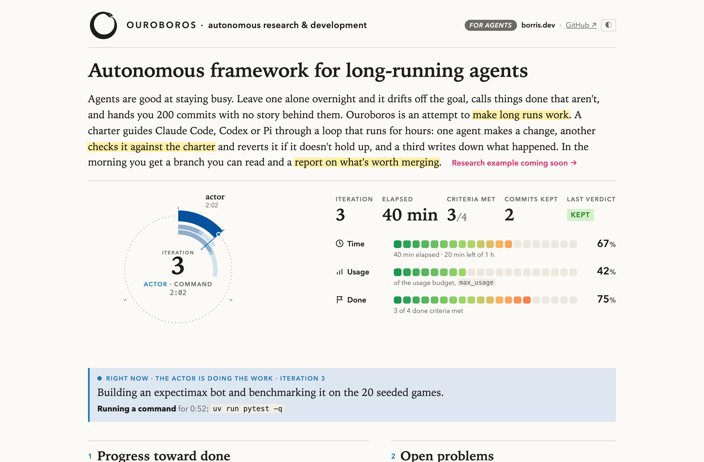

<p align="center">
  <picture>
    <source media="(prefers-color-scheme: dark)" srcset="docs/logo-dark.svg">
    
  </picture>
</p>

<h1 align="center">Ouroboros</h1>

<p align="center"><b>Autonomous framework for long-running agents</b></p>

<p align="center">
  <a href="https://borris.dev"></a>
  
  <a href="https://docs.astral.sh/uv/"></a>
  
  
  <a href="LICENSE"></a>
</p>

---

Agents are good at staying busy. Leave one alone overnight and it drifts off
the goal, calls things done that aren't, and hands you 200 commits with no
story behind them. Ouroboros is an attempt to make long runs work. A charter
guides Claude Code, Codex or Pi through a loop that runs for hours: one agent
makes a change, another checks it against the charter and reverts it if it
doesn't hold up, and a third writes down what happened. In the morning you get
a branch you can read and a report on what's worth merging.

<a href="https://borris.dev">
  <picture>
    <source media="(prefers-color-scheme: dark)" srcset="docs/site-dark.png">
    
  </picture>
</a>

## Install

You need Python 3.12+, [`uv`](https://docs.astral.sh/uv/), and at least one
logged-in agent CLI: `claude`, `codex` or `pi`. To outlive the terminal, a run
uses tmux, tern or a systemd user session (`launcher:` in the config).

```bash
git clone https://github.com/theo-kirby/ouroboros.git && cd ouroboros
uv tool install --editable .
ouroboros skills install --user
```

## Run

In the repo you want worked on, from a clean working tree:

```bash
ouroboros init            # config and charter template
ouroboros design          # write the charter with an agent, by interview
ouroboros run --for 8h    # start the loop (and the phone reporter)
ouroboros top             # watch it
ouroboros view            # its live page in a browser
ouroboros report          # read what happened
ouroboros stop            # stop early
```

`ouroboros` with no arguments opens a menu. Read the report and the run branch
before you merge.

## How it works

| Role | Each iteration |
|---|---|
| **Actor** | Does one unit of work from the critic's prompt, to the end, and tests it. |
| **Critic** | Read-only. Grades the change against the charter, reverts what fails, refuses an unsupported "done", answers the actor's questions as you would, and writes the next prompt. |
| **Scribe** | Records what happened (a rejected change as a dead end), folds the memory when due, and updates the run's page. |

**The charter** (`.ouroboros/goal.md`) speaks for you while you are away: a
mission, done criteria written as claims about the world, a horizon ladder, constraints,
a question policy and a quality bar. No agent can edit it. "Done" is a verdict,
not a stop: once the criteria are met, the run climbs the horizon ladder.

**It never blocks.** Questions go to the critic. A usage limit switches the role
to its fallback harness or waits for access to return. Only a stop you set ends
a run: `stop.after`, `until`, `max_iterations`, `max_usage`, or a long run of
"stuck" verdicts.

**It watches for motion without progress.** Two counters an agent cannot argue
with: 8 iterations that change only bookkeeping, or 30 that leave the frontier
unchanged. The next prompt names the loop; if it goes on, the actor moves to its
fallback model.

## Configuration

`.ouroboros/config.yml`, for example:

```yaml
roles:
  actor:  { harness: claude, timeout: 90m, fallback: [{ harness: codex }] }
  critic: { harness: codex,  timeout: 10m, fallback: [{ harness: claude }] }
  scribe: { harness: claude, model: sonnet, fallback: [{ harness: codex }] }
stop: { after: 8h, max_usage: 0.8 }
memory: auto
```

A subscription rations by window, so a run meters windows, not dollars.
`max_usage` stops the run when any window of a day or longer (in practice the
weekly one) reaches that fraction; five-hour windows refill on their own.
`cost_usd` is priced at API list rates, not your bill. After switching a login
or getting usage back, `ouroboros refresh` rechecks the accounts and wakes a
waiting run.

## The run's page

Every run keeps a live page at `.ouroboros/runs/<run>/view/index.html`: the
loop as a dial, the key figures, gauges for time, usage and progress toward
done, the criteria, open problems, the memory graph, the scribe's findings and
a timeline of every iteration. `ouroboros view --host 0.0.0.0` serves it to a
phone, for example over Tailscale. A repo can bring its own template at
`.ouroboros/view/template.html`. [borris.dev](https://borris.dev) is a page in
this style.

`ouroboros watch` (started by `run`) pushes alerts and a digest every four
hours to [Pushover](https://pushover.net): put `PO_USER` and `PO_TOKEN` in
`.env`, `.ouroboros/.env` or `~/.ouroboros/.env`, and check it with
`ouroboros watch --test`.

## Memory

Records are append-only, and each says what it changes. State is a set of
claims that cite records; only the scribe's fold writes state. The next actor
reads the state and the records not folded yet. Agents reach it through one
command, `ouroboros mem orient | show | record | fold | check | render`, and
each role may use only its own verbs.

By default the memory is markdown under `.ouroboros/graph/`, committed with the
code on the run branch. It needs nothing else installed.

### Optional: Governor

[Governor](https://github.com/theo-kirby/governor) keeps the same records and
claims as a graph in [Flywheel](https://docs.flywheel.paradigma.inc), Paradigma's
research graph, with its whole history in a local Flywheel repository that can
sync to a hosted one. It needs Node and the `flywheel` CLI:

```bash
flywheel repo:init                    # at the checkout; gitignore .flywheel/ and .governor/
governor init --title "My project"
```

With `.flywheel/db.sqlite` at the checkout and `governor` on `PATH`,
`memory: auto` picks it; `--memory files|governor` forces one. Every memory
write is then a Flywheel commit, so merge the run branch with a merge commit:
records cite commit IDs that a squash or rebase would change.

The run page draws its memory graph with Governor's viewer either way. It is
vendored in `src/ouroboros/vendor/`, so files memory needs no Node.

## Development

```bash
uv run pytest -q
```

Role prompts are skills in `src/ouroboros/skills/`. [AGENTS.md](AGENTS.md) is
the contract for changes to this repo, and [DESIGN.md](DESIGN.md) holds the
design, the decisions and the lessons from real runs.
