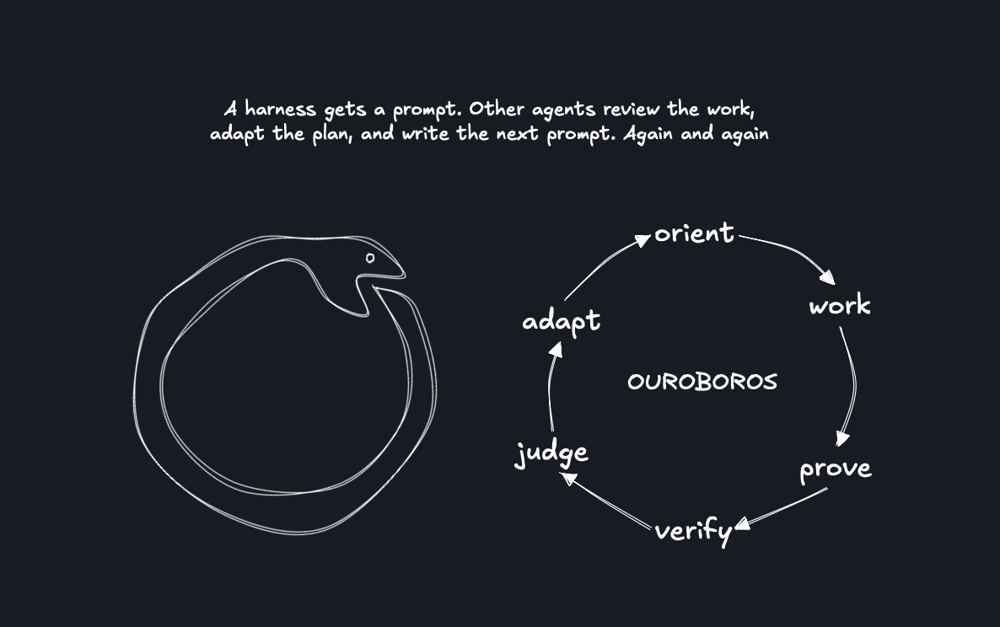

# Ouroboros

Run Claude Code, Codex, or Pi on a repo indefinitely. You set the goal; agents
make changes and check the work. Ouroboros keeps a record.



## Install

You need Python 3.12+, `uv`, and at least one agent CLI installed and logged
in: `claude`, `codex`, or `pi`. To outlive the terminal, a run needs one of
tmux, tern, or a systemd user session (`launcher:` in the config).

```bash
git clone https://github.com/theo-kirby/ouroboros.git
cd ouroboros
uv tool install --editable .
ouroboros skills install --user
```

## Run

From the repo you want the agents to work on:

```bash
ouroboros init                 # create the config and goal template
ouroboros design               # work through your goal with an agent
ouroboros run --for 8h         # under config `launcher:`: a systemd unit, a tern session, or tmux
ouroboros top                 # watch progress
ouroboros stop                # stop early if needed
ouroboros report              # write a run report
ouroboros watch               # push alerts and a 4-hourly digest to your phone (run starts it for you)
```

Start with a clean working tree and a completed goal. Run `ouroboros` with
no arguments for an interactive menu.

Your goal lives in `.ouroboros/goal.md`, called the **charter**. It defines
what to build, the constraints, and what counts as done. The critic picks each
next step from it, but no agent can edit the charter.

## The loop

- **Actor:** picks one task, does the work, tests it, and records the result.
  When the memory says a reconcile is due, its next iteration is housekeeping.
- **Critic:** one read-only call after every actor turn. It reviews the change
  against the quality bar, answers the actor's questions as you would, refuses
  claims of completion that do not hold up, names loops, and writes the message
  the next iteration starts from. Rejected changes are reverted by default.

There are no other roles. The critic's reply names the next unit.

If an agent hits a usage limit, Ouroboros switches to a configured fallback
or waits for access to return. By default the actor falls back from Claude to
Codex. Set roles and limits in `.ouroboros/config.yml`:

```yaml
roles:
  actor: { harness: claude, timeout: 90m, fallback: [{ harness: codex }] }
  critic: { harness: codex, timeout: 10m, fallback: [{ harness: claude }] }
stop: { after: 8h, max_usage: 0.8 }
```

Dollars are the wrong meter for a subscription, which charges a flat fee and then
rations by window. So a run meters whatever its harnesses actually report: windows
for Claude Code and Codex, dollars for a harness on an API key. `max_usage` is a
fraction of a subscription's **weekly** window, because a five-hour window refills
on its own and the fallback covers the wait. `ouroboros status` and the report show
where each window sits and how far the run moved it.

## On your phone

`ouroboros watch` is a reporter outside the loop: it reads the run directory,
never the loop, and pushes to [Pushover](https://pushover.net). Put your user key
and an application token in `.env`, `.ouroboros/.env`, or `~/.ouroboros/.env`:

```
PO_USER=...     # your user key
PO_TOKEN=...    # an application token from pushover.net/apps/build
```

`ouroboros run` then starts the reporter beside the loop. It pushes fixed-text
alerts the moment they show in the files -- the run stopped, a harness ran out of
usage, `NEEDS_HUMAN.md` appeared, the critic called it stuck, the process died --
and a model-written digest every four hours and when the run ends: what landed,
what is next, what is broken, the numbers. Tune it under `report:` in the config.
`ouroboros watch --test` checks the phone; `--once` sends a digest now.

## Memory and review

Every run keeps the [governor](https://github.com/theo-kirby/governor) model:
append-only records, each declaring what it changes, and state claims that cite
them, written only by a fold. A repo with a governor graph (`.flywheel/db.sqlite`
at the checkout, `governor` on `PATH`) keeps it there. Any other repo keeps the
same records and claims as markdown files under `.ouroboros/graph/`, committed with
the code, shaped so they can seed a Flywheel graph later. `memory: auto` picks
governor when it is there and `files` otherwise; `--memory governor|files` forces
one (`handoff` is the old name of `files`).

Agents see one command either way: `ouroboros mem orient | show | record | fold |
check | render`. You can run it too. Keep `.flywheel/` and
`.governor/` gitignored (a governor run adds them to `.gitignore` if they are not).

Review the report and run branch before merging. Use a merge commit for
graph-memory runs: their records reference commit IDs, which squash and rebase change.

A run reports what it spent as the windows it burned, never as dollars: a
subscription's `total_cost_usd` is priced from token counts at API list rates
and is not your bill. Dollars appear only for a harness on an API key, which
has no windows and a real invoice.

## Development

```bash
uv run pytest -q
```

Role prompts live in `src/ouroboros/skills/`. See [DESIGN.md](DESIGN.md) for
the design, decisions, and lessons from real runs.

After switching a Claude/Codex login or restoring usage credits, run
`ouroboros refresh` (also `ouroboros --refresh`) in the project.
It rechecks the configured providers with small no-tool probes and wakes a
waiting run. Active calls finish first. Configuration changes still require
a restart.

View a run in your browser with `ouroboros web`, then open
http://127.0.0.1:8765. Use `--run-name NAME` to select a run and `--port PORT`
to choose another port. The dashboard refreshes automatically; Ctrl-C stops
the web server.

Use `ouroboros web --demo` to preview the dashboard with labeled sample data.
